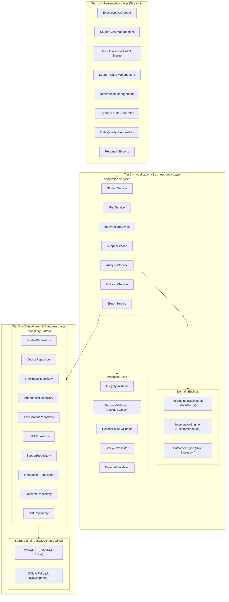

# EduRisk AI — System Architecture Specification

## 1. Architectural Overview

EduRisk AI strictly enforces a **Three-Tier Architecture**:

## 2. Tier Isolation Rules

1. **Presentation Layer Isolation:**
   - Streamlit pages never execute raw SQL or query tables directly.
   - All interactions go through `application.services`.
   - Business calculations, risk scoring, and data reconciliations remain entirely in Tier 2.

2. **Application Layer Responsibilities:**
   - Orchestrates domain engines and repository queries.
   - Enforces temporal cutoffs on risk observation windows to eliminate future data leakage.
   - Manages support case triage queues and status transitions.
   - Executes validation rules against raw records and injected fixtures.

3. **Data Layer Responsibilities:**
   - Repository pattern abstracts all SQLAlchemy queries.
   - Explicit session management via scoped sessions and transaction context managers (`session_scope()`).
   - Foreign key cascading and indexed queries for sub-second retrieval.

