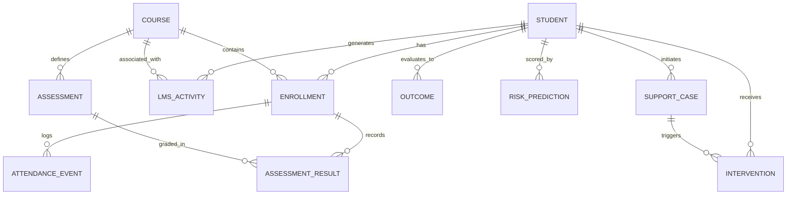

# EduRisk AI — Database Schema & Entity Relationships

## 1. Entity-Relationship Diagram

## 2. Table Specifications

### 1. `students`
- `id` (VARCHAR(32), PK): Deterministic ID `STU-2026-000001`
- `first_name` (VARCHAR(64), NOT NULL)
- `last_name` (VARCHAR(64), NOT NULL)
- `email` (VARCHAR(128), UNIQUE, INDEX)
- `cohort` (VARCHAR(32), INDEX)
- `status` (VARCHAR(32), INDEX): `Active`, `Withdrawn`, `Graduated`, `Suspended`
- `enrollment_date` (DATE, NOT NULL)
- `withdrawal_date` (DATE, NULLABLE)
- `created_at`, `updated_at` (DATETIME)

### 2. `courses`
- `id` (VARCHAR(32), PK): Deterministic ID `CRS-000001`
- `code` (VARCHAR(32), UNIQUE, INDEX): e.g. `CS101`
- `title` (VARCHAR(128), NOT NULL)
- `department` (VARCHAR(64), INDEX)
- `credits` (INT, NOT NULL)
- `instructor_name` (VARCHAR(128))
- `semester` (VARCHAR(32), INDEX): e.g. `Fall 2026`, `Spring 2026`
- `created_at`, `updated_at` (DATETIME)

### 3. `enrollments`
- `id` (VARCHAR(64), PK): `ENR-{student_id}-{course_id}`
- `student_id` (VARCHAR(32), FK -> students.id)
- `course_id` (VARCHAR(32), FK -> courses.id)
- `status` (VARCHAR(32), INDEX): `Enrolled`, `Completed`, `Withdrawn`, `Dropped`
- `enrollment_date` (DATE)
- `completion_date` (DATE, NULLABLE)
- `final_grade` (FLOAT, NULLABLE)

### 4. `attendance_events`
- `id` (VARCHAR(96), PK): `ATT-{enrollment_id}-{session_date}`
- `enrollment_id` (VARCHAR(64), FK -> enrollments.id)
- `student_id` (VARCHAR(32), FK -> students.id, INDEX)
- `course_id` (VARCHAR(32), FK -> courses.id)
- `session_date` (DATE, INDEX)
- `status` (VARCHAR(32)): `Present`, `Late`, `Absent_Approved`, `Absent_Unapproved`
- `session_type` (VARCHAR(32)): `Lecture`, `Lab`, `Seminar`
- `notes` (VARCHAR(255), NULLABLE)

### 5. `assessments`
- `id` (VARCHAR(48), PK): `ASM-{course_id}-{seq}`
- `course_id` (VARCHAR(32), FK -> courses.id)
- `title` (VARCHAR(128))
- `assessment_type` (VARCHAR(32)): `Quiz`, `Assignment`, `Midterm`, `Final Exam`, `Project`
- `max_score` (FLOAT, DEFAULT 100.0)
- `weight` (FLOAT, DEFAULT 0.20)
- `due_date` (DATE, INDEX)

### 6. `assessment_results`
- `id` (VARCHAR(96), PK): `ASR-{assessment_id}-{student_id}`
- `assessment_id` (VARCHAR(48), FK -> assessments.id)
- `student_id` (VARCHAR(32), FK -> students.id)
- `enrollment_id` (VARCHAR(64), FK -> enrollments.id)
- `score` (FLOAT, NULLABLE): NULL if missing/unsubmitted
- `submission_date` (DATE, NULLABLE)
- `status` (VARCHAR(32)): `Graded`, `Submitted`, `Late`, `Missing`, `Excused`

### 7. `lms_activities`
- `id` (VARCHAR(32), PK): `LMS-2026-000001`
- `student_id` (VARCHAR(32), FK -> students.id)
- `course_id` (VARCHAR(32), FK -> courses.id, NULLABLE)
- `activity_type` (VARCHAR(32)): `Login`, `Content_View`, `Assignment_Submit`, `Forum_Post`, `Quiz_Attempt`
- `duration_seconds` (INT)
- `timestamp` (DATETIME, INDEX)

### 8. `support_cases`
- `id` (VARCHAR(32), PK): `CAS-2026-000001`
- `student_id` (VARCHAR(32), FK -> students.id)
- `risk_prediction_id` (VARCHAR(32), NULLABLE)
- `trigger_reason` (VARCHAR(255))
- `status` (VARCHAR(32)): `Open`, `Assigned`, `In Progress`, `Resolved`, `Closed`, `Escalated`
- `priority` (VARCHAR(32)): `Low`, `Medium`, `High`, `Critical`
- `assigned_staff` (VARCHAR(128))
- `opened_at` (DATETIME, INDEX)
- `resolved_at` (DATETIME, NULLABLE)
- `notes` (TEXT)

### 9. `interventions`
- `id` (VARCHAR(32), PK): `INT-2026-000001`
- `student_id` (VARCHAR(32), FK -> students.id)
- `case_id` (VARCHAR(32), FK -> support_cases.id, NULLABLE)
- `intervention_type` (VARCHAR(64)): `Academic Counselling`, `Attendance Follow-up`, `Mentoring`, `Learning Support`, `Parent/Guardian Communication`, `Study Plan`, `Faculty Meeting`
- `assigned_staff` (VARCHAR(128))
- `trigger_timestamp` (DATETIME, INDEX)
- `scheduled_date` (DATE, INDEX)
- `completion_date` (DATE, NULLABLE)
- `status` (VARCHAR(32)): `Scheduled`, `In Progress`, `Completed`, `Cancelled`, `No Show`
- `notes` (TEXT)
- `outcome_notes` (TEXT)

### 10. `outcomes`
- `id` (VARCHAR(32), PK): `OUT-2026-000001`
- `student_id` (VARCHAR(32), FK -> students.id)
- `course_id` (VARCHAR(32), NULLABLE)
- `evaluation_date` (DATE, INDEX)
- `outcome_label` (VARCHAR(64)): `Improved academic performance`, `Continued academic risk`, `Successful recovery`, `Course withdrawal`, `Course completion`
- `gpa_change` (FLOAT)
- `attendance_change` (FLOAT)
- `is_recovery` (BOOLEAN)
- `notes` (TEXT)

